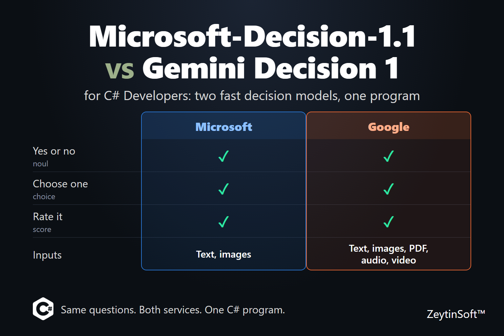

# Microsoft Decision 1.1 vs Gemini Decision 1 for C# Developers


> A runnable .NET 11 console app that sends the same three classification tasks to **Microsoft-Decision-1.1** (on Microsoft Foundry) and **Gemini Decision 1** (on the Gemini Developer API), then prints a side-by-side table of latency, input tokens and estimated cost.

[](https://github.com/taswar/Decision-1-1-vs-Gemini-Decision-1-CSharp-Sample/actions/workflows/dotnet.yml)

[](LICENSE)
[](CONTRIBUTING.md)

- ⭐ If this sample helps you, star the repo so other .NET developers can find it.
- 🔁 Related: [GPT-6.2 Astra vs Sol C# Sample](https://github.com/taswar/GPT-6.2-Astra-vs-Sol-CSharp-Sample)

It's one `Program.cs` with no wrapper library. Both services get the same questions about the same inputs. Only the request JSON differs, so the differences you see come from the services and not from the prompts.

## What's inside

| # | Case | Input | What it shows |
|---|------|-------|---------------|
| 1 | **ticket-text** | A support ticket as text | Three question types at once: a `choice` (which team), a `score` (severity on four levels) and a `noul` (is this a repeat contact). |
| 2 | **screenshot** | `checkout-error.png` | Image input. Is an error visible, and what kind of problem is it? |
| 3 | **invoice-pdf** | `invoice.pdf` | PDF input. Does it show a PO number, and is the total over 5,000? Microsoft's documented API takes images only, so it is reported as `not supported` here. |

Each case runs `RUNS` times (default 5). The two services alternate on every round so both see the same network conditions, and the app reports the **median** latency. When all cases finish, it prints a table like this one (placeholders, not real results):

```
case           service                     latency  in tokens    est. cost
ticket-text    Microsoft-Decision-1.1         ... ms        ...          ...
ticket-text    Gemini Decision 1              ... ms        ...          ...
```

Estimated cost is input tokens times `PricePerMillionInput` in `Program.cs`. Those prices are hard-coded from the launch announcements, so check the current pricing pages before you rely on the numbers.

## Prerequisites

- **.NET 11 SDK**
- A **Microsoft Foundry** resource with a Microsoft-Decision-1.1 deployment
- Either the **Azure CLI** signed in with `az login` (Entra ID through `DefaultAzureCredential`, the default), or an API key for the resource
- A **Gemini API key** from [Google AI Studio](https://aistudio.google.com/)

## Run it

**1. Clone the repo and store your settings** (user secrets are kept outside the repo):

```bash
git clone https://github.com/taswar/Decision-1-1-vs-Gemini-Decision-1-CSharp-Sample.git
cd Decision-1-1-vs-Gemini-Decision-1-CSharp-Sample
dotnet user-secrets set "AZURE_AI_ENDPOINT" "https://<your-resource>.services.ai.azure.com"
dotnet user-secrets set "GEMINI_API_KEY" "<your-gemini-key>"
dotnet user-secrets set "AZURE_AI_DEPLOYMENT" "<your-deployment-name>"
```

The deployment name defaults to `ms-decision-1.1`, so you only need the last line if yours is named differently. Use the **deployment** name, not the model name.

To use an API key for Foundry instead of Entra ID, also run `dotnet user-secrets set "AZURE_AI_API_KEY" "<key>"` and skip `az login`.

**2. Sign in and run:**

```bash
az login
dotnet run
```

## Configuration

Settings come from user secrets first, then environment variables, so you can also set them in the shell or in CI.

| Setting | Required | Default | Purpose |
|---------|----------|---------|---------|
| `AZURE_AI_ENDPOINT` | Yes | none | Base endpoint of your Foundry resource |
| `GEMINI_API_KEY` | Yes | none | Gemini Developer API key |
| `AZURE_AI_DEPLOYMENT` | No | `ms-decision-1.1` | Foundry deployment name |
| `AZURE_AI_API_KEY` | No | none | Sends an `api-key` header instead of an Entra ID bearer token |
| `RUNS` | No | `5` | Calls per service per case. The median latency is reported. |
| `GEMINI_ENDPOINT` | No | `https://generativelanguage.googleapis.com` | Only for proxies or tests |

## How the two APIs differ

Both services take a list of named questions and answer in the same shape. The question types are `choice`, `score` and `noul` (a probability that a statement is true). The request JSON is where they differ:

| | Microsoft-Decision-1.1 | Gemini Decision 1 |
|---|---|---|
| Endpoint | `POST {endpoint}/providers/microsoft/v1/systemone` | `POST /v1beta/decisions` |
| Auth | Entra ID bearer token or `api-key` header | `x-goog-api-key` header |
| Model | Your deployment name in `model` | `gemini-decision-1` |
| Input | `state` text, plus `assets` for images (referenced as `image:<name>`) | `input` list of blocks: text, image, audio, video or document (PDF) |
| `noul` criteria | `{ "true": ..., "false": ... }` | `{ true_description, false_description }` |
| Confidence | A `confidence` field came back on choice and score answers in my run, though the Learn page doesn't document it | A `confidence` field on every answer |

## Good to know

- **Live calls cost money.** One run makes up to `RUNS` calls per service per case.
- **Output varies.** Answers are model-generated. Compare latency across several runs, not just one.
- **Token usage for Microsoft is best effort.** The docs only say the response includes usage, so the app takes the first numeric field with `input` or `prompt` in its name. If none is found, tokens and cost show `n/a`.
- **Timeouts.** Each HTTP request has a 60-second timeout.
- **Sample inputs.** `checkout-error.png` and `invoice.pdf` are synthetic. Swap in your own files to test your own data.

## Troubleshooting

| Error | Likely cause | Fix |
|-------|--------------|-----|
| `InvalidOperationException: Set AZURE_AI_ENDPOINT.` / `Set GEMINI_API_KEY.` | Settings are missing | Run the `dotnet user-secrets set` commands from inside the project folder, or set environment variables |
| `404` from your Foundry host | `AZURE_AI_DEPLOYMENT` doesn't match a deployment on the resource | Set it to the exact deployment name. A new deployment can take a few minutes to become available. |
| `401` / `403` from Foundry | Missing role, `az login` signed in to the wrong tenant, or a bad key | Assign a suitable Cognitive Services role, run `az login --tenant <id>`, or check the key |
| `400` / `403` from Gemini | Invalid key, or the model isn't enabled for your key | Check the key in Google AI Studio |

## Dependencies

| Package | Version | Purpose |
|---------|---------|---------|
| `Azure.Identity` | 1.21.0 | `DefaultAzureCredential` for Entra ID sign-in |
| `Microsoft.Extensions.Configuration.UserSecrets` | 11.0.0 | Local development secrets |
| `Microsoft.Extensions.Configuration.EnvironmentVariables` | 11.0.0 | Settings from environment variables |

## Project layout

```
Decision-1-1-vs-Gemini-Decision-1-CSharp-Sample.csproj   Target framework, NuGet references, UserSecretsId
Program.cs                                               Cases, the two clients, the comparison table
checkout-error.png                                       Sample screenshot input
invoice.pdf                                              Sample PDF input
.github/workflows/dotnet.yml                             Build workflow (restore and build on every push and pull request)
CONTRIBUTING.md                                          How to build, validate and submit a change
LICENSE                                                  MIT license
```

## Learn more

- [.NET Secret Manager](https://learn.microsoft.com/aspnet/core/security/app-secrets)
- [Microsoft Foundry documentation](https://learn.microsoft.com/azure/ai-foundry/)
- [Gemini API documentation](https://ai.google.dev/gemini-api/docs)

If this saved you time, a ⭐ helps other .NET developers find it.
